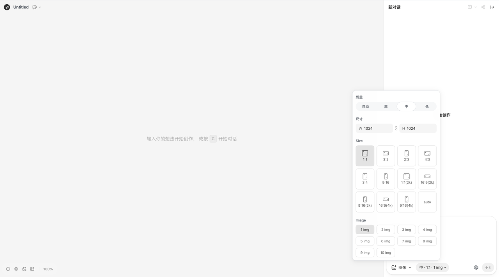

# 产品需求文档

## 创作首页 `/protected`

用户可在创作首页输入生图提示词、上传图片并进入项目页面，也可以查看最近项目并前往项目列表。

### 布局与交互

| 区域 | 需求 |
| --- | --- |
| 提示词输入框 | 按参考图在页面上方居中摆放。用户可以在输入框内输入生图需求的提示词。 |
| 图片上传 | 点击输入框内左下角的「+」按钮，可选择并上传图片。 |
| 发送 | 点击输入框内右下角的发送按钮，提交提示词及已上传的图片（如有），并跳转至 `/canvas?projectId={projectId}`。其中 `{projectId}` 为本次提交对应的项目 ID。 |
| 最近项目 | 在输入框下方展示「最近项目」，使用参考图中的横向卡片布局。点击「查看全部」进入 `/projects`，查看全部项目。 |

### 待确认问题

- 发送时如何取得项目 ID。
- 图片上传支持的格式、大小与数量。
- 最近项目的展示数量、排序规则，以及参考图中单个项目卡片和「新建项目」卡片的点击行为。

## 项目列表 `/projects`

用户可以从 `/protected` 的「最近项目」区域点击「查看全部」，进入项目列表。

### 布局与交互

| 区域 | 需求 |
| --- | --- |
| 项目列表 | 加载并展示当前用户的全部项目，按参考图使用多列卡片网格。 |
| 项目卡片 | 卡片展示项目封面、项目名称和更新时间。没有封面的项目使用参考图中的占位样式。 |
| 进入项目 | 点击已有项目卡片后，跳转至 `/canvas?projectId={projectId}`，其中 `{projectId}` 为所点击项目的 ID。 |

### 待确认问题

- 项目列表的排序规则与加载方式。
- 参考图中「新建项目」卡片的点击行为。

## 项目画布 `/canvas?projectId={projectId}`

页面根据 URL 中的 `projectId` 打开对应项目。项目为空时，按下图展示左侧画布和右侧生图对话面板。

### 页面布局

| 区域 | 需求 |
| --- | --- |
| 左侧画布 | 使用 `@xyflow/react` 实现。空状态在画布中央展示引导提示。 |
| 右侧生图对话面板 | 空状态展示「新对话」和「开始创作」提示，底部放置生图输入区和模型配置入口。 |
| 面板分隔线 | 拖动左右区域之间的分隔线可调整右侧面板宽度。右侧面板最小宽度为 `320px`，最大宽度为 `620px`，左侧画布随之调整。 |

### 生图模型配置

点击生图输入区的配置按钮，在按钮附近打开当前模型对应的配置弹框。配置变更后，按钮上的摘要文案随当前取值更新。

#### Nano Banana

- 模型图标使用 `@lobehub/icons` 的 `NanoBanana`。
- 弹框提供分辨率和宽高比选项。分辨率参考图中的 `512`、`1K`、`2K`、`4K`，宽高比以卡片网格呈现。
- 配置按钮显示当前分辨率和宽高比，例如「1K · 1:1」。修改任一选项后，更新对应文案。

#### GPT Image2

- 模型图标使用 `@lobehub/icons` 的 `OpenAI`。
- 弹框提供质量、宽度和高度、预设尺寸及生成张数。质量选项为「自动」「高」「中」「低」，预设尺寸和张数按参考图展示。
- 配置按钮显示当前质量、尺寸和生成张数，例如「中 · 1:1 · 1 img」。修改这些设置后，更新对应文案。

### 添加参考图

点击右侧生图输入区的「参考图」按钮，打开来源菜单。

| 来源 | 行为 |
| --- | --- |
| 从本地上传图片 | 打开本地文件选择器，将选中的图片上传至 Supabase Storage 的存储桶。上传成功后，使用该图片的远程地址作为参考图地址。 |
| 从画布选择 | 从当前画布选中一张图片，直接使用该图片已有的远程地址作为参考图地址，无需重复上传。 |

两种来源共用同一个参考图名额，每次提交最多携带 **1 张**参考图。添加成功后，在输入区显示该图片的缩略图。

### 生图状态

#### 生成中

点击发送后，右侧对话面板展示本次提交的提示词、参考图缩略图（如有）和模型配置摘要，并显示结果占位。左侧画布同步显示带「Generating」标记的图片占位。

#### 生成完成

生成成功后，左侧画布在占位位置显示生成图片，右侧对话面板将对应的结果占位替换为生成图片的缩略图。

### 待确认问题

- 右侧面板的初始宽度，以及是否记住拖动后的宽度。
- 两个模型的默认值、参数校验及自定义尺寸的摘要文案。
- 参考图存储桶、访问方式、文件格式和大小限制，以及已有参考图的移除与替换交互。
- 上传或生成失败时的提示和重试方式，以及项目内容的保存规则。
