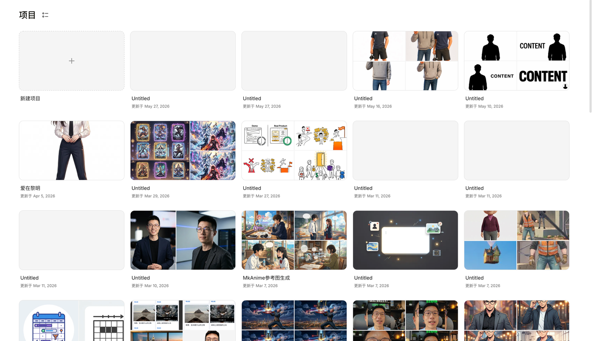
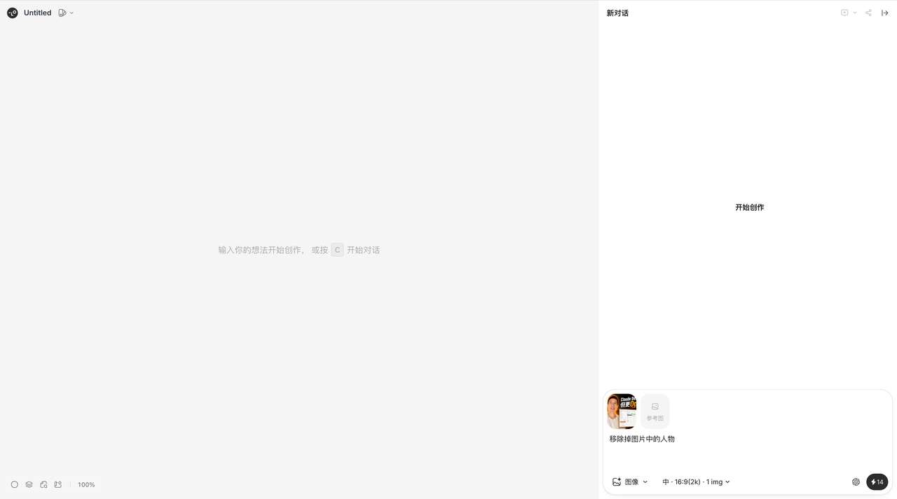
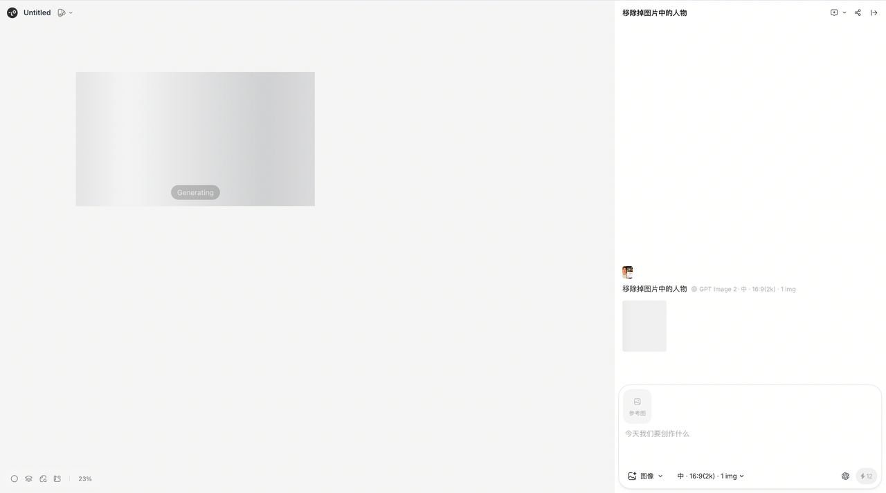
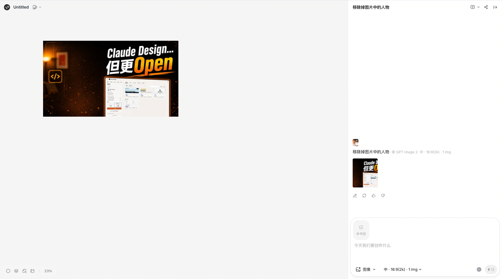

# 产品需求文档

## 使用权限

开放邮箱注册。用户设置密码并完成邮箱验证后，可登录工作台、管理自己的项目及发起生图任务。

## 创作首页 `/protected`

用户可在创作首页输入生图提示词、上传图片并进入项目页面，也可以查看最近项目并前往项目列表。

### 布局与交互

| 区域 | 需求 |
| --- | --- |
| 提示词输入框 | 按参考图在页面上方居中摆放。用户可以在输入框内输入生图需求的提示词。 |
| 图片上传 | 点击输入框内左下角的「+」按钮，可选择并上传图片；旁侧支持切换手动生图模型（Nano Banana 2、GPT Image 2、Seedream 5.5）及分辨率/宽高比参数。 |
| 发送 | 点击发送后创建项目，提交提示词及参考图（如有）作为首条生图任务，并跳转至 `/canvas?projectId={projectId}`。画布页根据任务状态显示生成中、生成完成或失败。 |
| 最近项目 | 在输入框下方展示「最近项目」，使用参考图中的横向卡片布局。点击「查看全部」进入 `/projects`，查看全部项目。 |

「最近项目」按更新时间倒序展示最近 4 个项目。点击已有项目进入对应画布，「新建项目」创建空项目并打开画布。首页和画布共用参考图的格式、大小和数量限制。

## 项目列表 `/projects`

用户可以从 `/protected` 的「最近项目」区域点击「查看全部」，进入项目列表。

### 布局与交互

| 区域 | 需求 |
| --- | --- |
| 项目列表 | 加载并展示当前用户的全部项目，按参考图使用多列卡片网格。 |
| 项目卡片 | 卡片展示项目封面、项目名称和更新时间。没有封面的项目使用参考图中的占位样式。 |
| 进入项目 | 点击已有项目卡片后，跳转至 `/canvas?projectId={projectId}`，其中 `{projectId}` 为所点击项目的 ID。 |

按更新时间倒序加载并分页展示项目。「新建项目」与首页行为一致。

## 项目画布 `/canvas?projectId={projectId}`

页面根据 URL 中的 `projectId` 打开对应项目。项目为空时，按下图展示左侧画布和右侧生图对话面板。

### 页面布局

| 区域 | 需求 |
| --- | --- |
| 左侧画布 | 使用 `@xyflow/react` 实现。空状态在画布中央展示引导提示。 |
| 右侧生图对话面板 | 空状态展示「新对话」和「开始创作」提示，底部放置生图输入区和模型配置入口。 |
| 面板分隔线 | 拖动左右区域之间的分隔线可调整右侧面板宽度。右侧面板最小宽度为 `320px`，最大宽度为 `620px`，左侧画布随之调整。 |

### 生图模型配置

点击生图输入区的配置按钮，在按钮附近打开当前模型对应的配置弹框。配置变更后，按钮上的摘要文案随当前取值更新。

#### Nano Banana 2

- 模型图标使用 `@lobehub/icons` 的 `NanoBanana`。
- 弹框提供分辨率和宽高比选项。分辨率为 `1K`、`2K`、`4K`，默认 `1K · 1:1`。宽高比以卡片网格呈现。
- 配置按钮显示当前分辨率和宽高比，例如「1K · 1:1」。修改任一选项后，更新对应文案。

#### GPT Image2

- 模型图标使用 `@lobehub/icons` 的 `OpenAI`。
- 弹框沿用参考图的布局，提供 API 支持的分辨率和宽高比组合，默认 `1K · 1:1`。配置按钮同步显示当前选择。
- 文生图和图生图均支持每次生成 **1–5 张**，默认 1 张。配置摘要同步显示张数，例如「1K · 1:1 · 3 张」。
- 当前 Kie.ai 规格仅提供预设宽高比和分辨率。质量与自定义宽高控件从首版移除。

#### Seedream 5.5

- 模型图标使用 `@lobehub/icons` 的 `ByteDance`，在 `/protected` 与 `/canvas` 手动生图模型菜单中可选。
- 复用现有 Kie.ai（`KIE_API_KEY`）渠道，无参考图时调用 `seedream/5-5-text-to-image`，含参考图时调用 `seedream/5-5-image-to-image`（`image_urls`）。
- 分辨率提供 `1K`、`1.5K`、`2K` 三档（默认切入 `2K`），宽高比支持 `1:1`、`4:3`、`3:4`、`16:9`、`9:16`、`2:3`、`3:2`、`21:9`、`auto`（文生图下选择 `auto` 时服务端自动按 `1:1` 提交），提示词长度校验为 `5–5,000` 字符，每次生成 1 张。

### 添加参考图

点击右侧生图输入区的「参考图」按钮，打开来源菜单。

| 来源 | 行为 |
| --- | --- |
| 从本地上传图片 | 打开本地文件选择器，将选中的图片上传至 Supabase Storage 的存储桶。上传成功后，使用该图片的远程地址作为参考图地址。 |
| 从画布选择 | 从当前画布选中一张图片，直接使用该图片已有的远程地址作为参考图地址，无需重复上传。 |

两种来源共用同一个参考图名额，每次提交最多携带 **1 张**参考图。本地上传接受 JPEG、PNG 和 WebP，首版单张上限为 10 MB。添加后在输入区显示缩略图，用户可移除或替换。

### 生图状态

#### 生成中

点击发送后，右侧对话面板展示本次提交的提示词、参考图缩略图（如有）和模型配置摘要，并显示结果占位。左侧画布同步显示带「Generating」标记的图片占位。

#### 生成完成

生成成功后，左侧画布在占位位置显示生成图片，右侧对话面板将对应的结果占位替换为生成图片的缩略图。

一次生成多张时，每张图独立显示生成状态。部分失败时保留成功图片，并允许重试失败项。

#### 生成失败与恢复

提交失败时保留提示词和参考图。已创建的生图任务失败时，在对话中显示失败原因与重试入口，并将对应画布占位标为失败。重试沿用原参数，刷新或重新打开项目时恢复已提交的任务与画布图片。

### 待确认问题

- 参考图上的积分数字是否对应真实的额度或计费。

页面交互与持久化约定见 [项目生图接入设计](./api/image-generation.md)。

## 画布 Agent

- 右侧对话输入框底部工具栏最左侧提供「Agent / 生图」下拉菜单，向上展开，支持键盘选择、Esc 和点击外部关闭。生成或上传期间禁用模式切换，窄屏下配置可换行，发送按钮保持可用。Agent 模式展示「Agent自动规划」，生图模式保留现有模型、比例与分辨率配置。两种模式使用同一对话区和输入框。
- 「附件」支持图片和 Markdown，可选择本地文件、拖入或粘贴。文件保存至现有 Supabase 私有存储桶。图片显示缩略图，Markdown 显示宽度不超过 240 px 的附件卡片，支持预览和下载。服务端读取 Markdown 原文交给 Agent。
- 点击画布图片可按顺序加入参考素材。Agent 可列出素材、实际查看图片、生成图片、将素材放入画布及读取画布。上传图片在画布可见，可拖动、等比缩放、复制粘贴和删除。画布节点按图片实际比例显示，文本编辑时忽略删除快捷键。刷新后恢复节点及删除状态，删除节点保留原素材。
- 用户消息靠右紧凑展示文字和附件。发送后立即清空输入区，已发送消息保留附件。Agent 回复、思考摘要与工具事件实时流式更新。Markdown 安全渲染，工具卡片可展开参数、结果和错误。
- Agent 固定使用 KIE GPT Image 2.5 Flare。无参考图时使用文生图，有参考图时按顺序传递图生图参考素材。保存实际模型、参数与参考素材，生成结果进入已有记录、素材库及画布。重试沿用原模型和素材。

Agent 规划、视觉理解和工具调用使用 DeepSeek Flash，图片生成使用 KIE GPT Image 2.5 Flare。

### Agent Skill

- 右侧「附件」旁提供「Skill」入口。用户可上传 `SKILL.md`，在当前项目内查看技能名称和最多两行的简介、选择本次技能或移除自己的技能。
- 技能保存 YAML frontmatter 中的 `name`、`description` 以及完整 Markdown 正文。技能按用户和项目隔离。
- 已发送的用户消息保存技能名称，并与输入文字和附件一起显示。发送后清空草稿和技能选择。
- [公众号封面示例技能](./skills/wechat-cover/SKILL.md)读取 Markdown 原文并先询问风格，用户选择后用现有 GPT Image 2.5 Flare 流程提交四张同风格、不同构图的宽幅封面。

## 个人中心与 Pro 订阅

- 登录后从工作台进入个人中心，查看订阅状态、到期时间、当月剩余生图额度及最近订单。
- Pro 月度订阅为人民币 0.10 元，支持支付宝和微信支付。每次手动续订一个自然月长度，有效期内提前续订从当前到期时间开始，过期后从本次入账时间开始。
- 免费用户每个北京时间自然月可生成 3 张图，Pro 生效期间上限为 50 张。普通生图和 Agent 共用额度，多图按张数计数。新一轮重新生成占用新额度，同一失败任务的重试不重复扣减。额度从功能启用后的新请求开始计数。
- 支付成功以服务端验证 ZPAY 异步通知并完成入账为准。
- 待付款订单保留 10 分钟付款窗口：10 分钟内展示实时倒计时并可点击「去付款」继续完成原订单支付；超过 10 分钟未付款的订单自动取消为「取消付款」（不可点击），服务端同时将其标记为失效以防止重复入账。

## 官网落地页 `/`

- 根路由 `/` 按 `Navbar → Hero → Benefits → Features → Pricing → FAQ → Footer` 结构展示画布生图、Agent 协同、Agent Skill 与公众号排版能力。
- 右上角根据登录状态切换入口：未登录展示「登录」「免费注册」，已登录展示「个人中心」「进入工作台」。

## 公众号排版工作台 `/typography`

- 采用左右分栏布局：左侧为「主题 → 子模板」两级模板选择器、配色与局部样式面板及 Markdown 正文编辑器；右侧为微信公众号手机端（390px）/ 电脑端（677px）实时预览视口。
- 模板库分为 5 大主题（极简阅读、深度专栏、科技产品、图文故事、品牌发布），每主题至少 2 套子模板（共 10 套）及至少 4 套预设配色，并支持自定义主色、强调色、正文色、背景色与边框色。
- 6 篇历史公众号文章样本（「未来文化力实验室」「映月湖创新沙龙」「AI 视觉工作坊」「遇见巴黎交流会」「工业专家招募」「翎析 AI 报道」）均作为可追溯子模板保留并兼容旧版模板 ID 与本地持久化迁移。
- 支持标题（纯文字、左竖线、编号、底色条、下划线及角标/胶囊变体）、无序/有序列表、图片（通栏、留白、圆角、细边框且保留宽高比）、分割线（细实线、虚线、短线、点阵、留白）与正文段落的细粒度局部调节。
- 切换主题或子模板仅应用样式不覆盖当前正文；提供独立「加载示例」（有正文时先确认）与「恢复模板默认」按钮；预览与「一键复制到公众号」共用同一份内联 HTML 渲染输出。
- **双栏无滚动条同步对齐**：左侧编辑区（含 Markdown 自由排版与画布结构化排版稿两种模式）均移除内部滚动条，输入框按内容高度自动撑开，顶部格式栏吸顶，使左侧编辑区与右侧预览区随页面自然滚动左右并排对齐；画布排版稿支持点击预览块与左侧编辑块双向选中定位。
- **秀米式左侧图文组件抽屉**：工作台最左侧提供可收起的分类抽屉栏（标题、卡片、图片、布局、SVG、组件六大分类），主要用于将所选图文模板套用到当前选中段落/块（保留原有文字或画布配图），同时支持一键插入新组件块与还原默认样式，生成的内联 HTML / SVG SMIL 原生兼容微信公众号后台粘贴。

## 画布交互增强与个人中心排版稿归档

- **画布文本节点中文输入法（IME）兼容**：`/canvas` 文章文本节点在拼音输入组合态（`compositionstart` → `compositionend`）期间保持本地受控缓冲，不打断候选词上屏，并在组合结束后同步画布状态与后端持久化。
- **画布直接粘贴外部图片**：`/canvas` 支持快捷键粘贴外部截图或剪贴板图片（非输入框焦点下），自动标准化为 PNG/JPEG/WebP、上传存入当前项目 `studio_assets` 素材库并放置到画布视口。
- **Qwen 排版结果保存与个人中心查看**：Qwen 生成及人工精修后的结构化排版稿持久保存于 `studio_article_drafts`；用户在 `/profile`「我的排版稿」区域可随时浏览历史排版稿列表、弹窗预览手机/电脑端公众号渲染效果，或点击「继续编辑」一键跳回 `/typography?draftId=...` 精修并复制发布。

## 画布生成公众号文章流程

- **画布文章编排与暂存**：`/canvas` 增加「文章编排」模式，支持手动添加与编辑文本节点（用途分为「创作素材」「写作要求」「原文保留」，默认「创作素材」），并复用画布上传图与生成图；通过有向连线表示文章顺序并在节点上显示顺序号。暂存前校验并展示按顺序排列的有效主链与未采用节点：多条独立链时由用户选定一条，分叉或环路需先修复，单个有内容的节点亦可暂存。每次暂存写入 Supabase 不可变版本（`studio_article_snapshots`），画布后续修改不影响历史版本。
- **选择模板与 Qwen 生成**：`/typography` 提供「从画布生成」三步引导（确认模板 → 确认暂存版本 → 应用模板并排版），固定暂存版本 ID 与完整模板样式创建持久化任务（`studio_article_tasks`），支持刷新继续查看、重复点击复用运行中任务、失败按原输入重试。服务端校验图片项目归属并将压缩后的图片与有序节点发送给 `qwen3.7-plus` 进行读图扩写与结构化输出；缺乏依据的人名、日期、数据或引语写入 `warnings` 提请用户核对；「原文保留」块由服务端按快照原文逐字写入。
- **人工精修与公开图片复制发布**：生成结果保存为独立排版稿（`studio_article_drafts`，带 `version` 乐观锁防止多窗口并发覆盖），重新调用 Qwen 另建新稿保留旧稿人工修改。编辑、预览与导出共用结构化稿件数据源与渲染函数，支持标题文字/层级编辑以及全文与选区局部的字号、字体样式、加粗、斜体和颜色，按「模板默认 → 全文设置 → 局部设置」优先级生效。首次点击「一键复制到公众号」时提示公开图片说明并请用户确认，仅对实际导出的图片在独立公开存储桶 `published-article-images` 生成副本并记录稳定映射（`studio_published_images`），副本与原件独立保留，全部图片准备成功后再写入剪贴板。

### 从画布生成公众号文章

#### 已确认需求

- 用户在项目画布中手动添加文本和图片，并通过有方向的连线确定文章的基本顺序。画布支持暂存，以供后续排版时选择。
- 用户进入公众号排版工作台后，先选择并确认模板，再选择并确认一份暂存的画布，最后点击「应用模板并排版」。系统根据选定的画布内容和模板调用 Qwen，分析结束后生成排版结果并展示预览。
- 画布文本可以是零散想法、提纲、小标题或详细描述。Qwen 可以把这些素材扩写、改写为可发布的正文，并按连线确定的基本顺序组织文字和图片。模型通过服务端读取 Qwen 配置。
- 排版结果需要使用所选公众号模板的实际样式预览。用户可以在预览阶段人工调整字号、字体样式、标题和颜色等，复制结果应与复制时的预览一致。
- 图片支持生成可长期访问的发布副本。复制到微信公众号后台的富文本应使用可发布的图片地址，以便保存草稿和发布后继续访问。

#### 待确认问题

- 文本节点是否提供「创作素材」「写作要求」「原文保留」标记，分别用于指导扩写、约束写作和保留引语或专有表述。文章语气、目标读者和篇幅是否需要独立设置。
- 初版是否按单条有向链编排文章，以及如何提示未连接节点、分支和环路。暂存是否保留多个可选版本。
- 预览编辑需要支持哪些粒度。候选包括全文的模板参数、单段或选中文字的样式，以及标题文字和层级。同一暂存版本重新排版时，需要确定如何处理已有的人工编辑结果。
- 发布副本何时生成或撤销，以及如何处理已被公众号文章引用的图片。初版上线前需验证复制、保存公众号草稿、重新打开及发布后的图片可用性。
