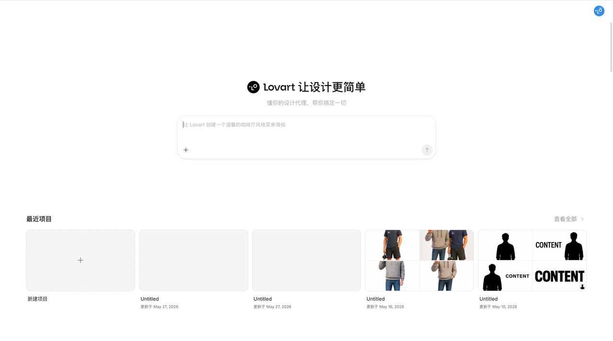
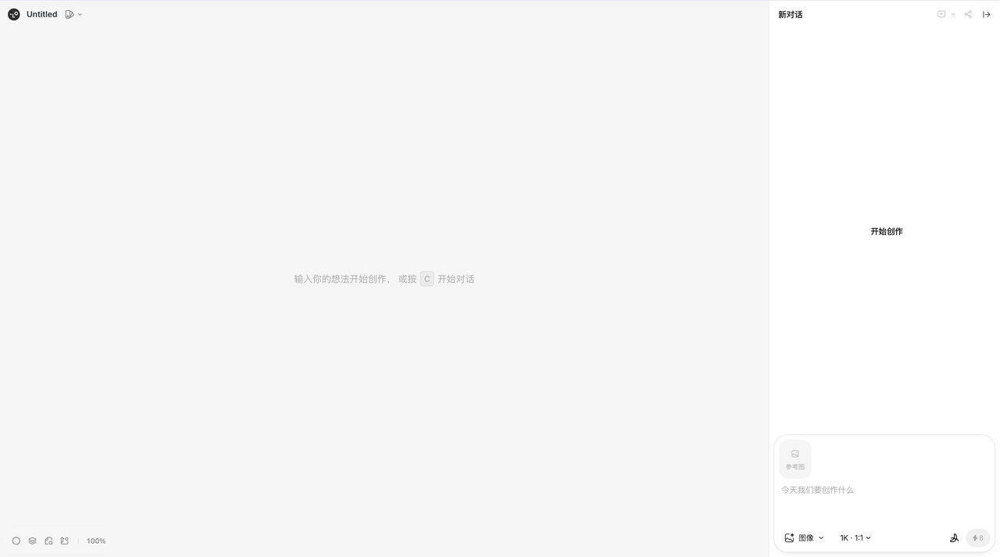
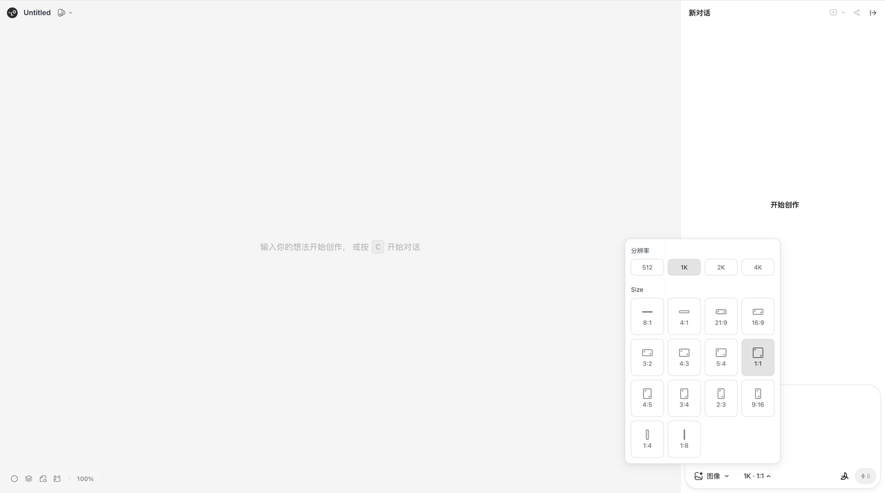
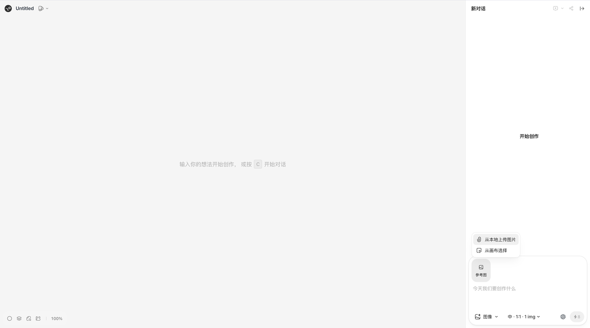

# 产品需求文档

## 使用权限

开放邮箱注册。用户设置密码并完成邮箱验证后，可登录工作台、管理自己的项目及发起生图任务。

## 创作首页 `/protected`

用户可在创作首页输入生图提示词、上传图片并进入项目页面，也可以查看最近项目并前往项目列表。

### 布局与交互

| 区域 | 需求 |
| --- | --- |
| 提示词输入框 | 按参考图在页面上方居中摆放。用户可以在输入框内输入生图需求的提示词。 |
| 图片上传 | 点击输入框内左下角的「+」按钮，可选择并上传图片。 |
| 发送 | 点击发送后创建项目，提交提示词及参考图（如有）作为首条生图任务，并跳转至 `/canvas?projectId={projectId}`。画布页根据任务状态显示生成中、生成完成或失败。 |
| 最近项目 | 在输入框下方展示「最近项目」，使用参考图中的横向卡片布局。点击「查看全部」进入 `/projects`，查看全部项目。 |

「最近项目」按更新时间倒序展示最近 4 个项目。点击已有项目进入对应画布，「新建项目」创建空项目并打开画布。首页和画布共用参考图的格式、大小和数量限制。

## 项目列表 `/projects`

用户可以从 `/protected` 的「最近项目」区域点击「查看全部」，进入项目列表。

### 布局与交互

| 区域 | 需求 |
| --- | --- |
| 项目列表 | 加载并展示当前用户的全部项目，按参考图使用多列卡片网格。 |
| 项目卡片 | 卡片展示项目封面、项目名称和更新时间。没有封面的项目使用参考图中的占位样式。 |
| 进入项目 | 点击已有项目卡片后，跳转至 `/canvas?projectId={projectId}`，其中 `{projectId}` 为所点击项目的 ID。 |

按更新时间倒序加载并分页展示项目。「新建项目」与首页行为一致。

## 项目画布 `/canvas?projectId={projectId}`

页面根据 URL 中的 `projectId` 打开对应项目。项目为空时，按下图展示左侧画布和右侧生图对话面板。

### 页面布局

| 区域 | 需求 |
| --- | --- |
| 左侧画布 | 使用 `@xyflow/react` 实现。空状态在画布中央展示引导提示。 |
| 右侧生图对话面板 | 空状态展示「新对话」和「开始创作」提示，底部放置生图输入区和模型配置入口。 |
| 面板分隔线 | 拖动左右区域之间的分隔线可调整右侧面板宽度。右侧面板最小宽度为 `320px`，最大宽度为 `620px`，左侧画布随之调整。 |

### 生图模型配置

点击生图输入区的配置按钮，在按钮附近打开当前模型对应的配置弹框。配置变更后，按钮上的摘要文案随当前取值更新。

#### Nano Banana 2

- 模型图标使用 `@lobehub/icons` 的 `NanoBanana`。
- 弹框提供分辨率和宽高比选项。分辨率为 `1K`、`2K`、`4K`，默认 `1K · 1:1`。宽高比以卡片网格呈现。
- 配置按钮显示当前分辨率和宽高比，例如「1K · 1:1」。修改任一选项后，更新对应文案。

#### GPT Image2

- 模型图标使用 `@lobehub/icons` 的 `OpenAI`。
- 弹框沿用参考图的布局，提供 API 支持的分辨率和宽高比组合，默认 `1K · 1:1`。配置按钮同步显示当前选择。
- 文生图和图生图均支持每次生成 **1–5 张**，默认 1 张。配置摘要同步显示张数，例如「1K · 1:1 · 3 张」。
- 当前 Kie.ai 规格仅提供预设宽高比和分辨率。质量与自定义宽高控件从首版移除。

### 添加参考图

点击右侧生图输入区的「参考图」按钮，打开来源菜单。

| 来源 | 行为 |
| --- | --- |
| 从本地上传图片 | 打开本地文件选择器，将选中的图片上传至 Supabase Storage 的存储桶。上传成功后，使用该图片的远程地址作为参考图地址。 |
| 从画布选择 | 从当前画布选中一张图片，直接使用该图片已有的远程地址作为参考图地址，无需重复上传。 |

两种来源共用同一个参考图名额，每次提交最多携带 **1 张**参考图。本地上传接受 JPEG、PNG 和 WebP，首版单张上限为 10 MB。添加后在输入区显示缩略图，用户可移除或替换。

### 生图状态

#### 生成中

点击发送后，右侧对话面板展示本次提交的提示词、参考图缩略图（如有）和模型配置摘要，并显示结果占位。左侧画布同步显示带「Generating」标记的图片占位。

#### 生成完成

生成成功后，左侧画布在占位位置显示生成图片，右侧对话面板将对应的结果占位替换为生成图片的缩略图。

一次生成多张时，每张图独立显示生成状态。部分失败时保留成功图片，并允许重试失败项。

#### 生成失败与恢复

提交失败时保留提示词和参考图。已创建的生图任务失败时，在对话中显示失败原因与重试入口，并将对应画布占位标为失败。重试沿用原参数，刷新或重新打开项目时恢复已提交的任务与画布图片。

### 待确认问题

- 参考图上的积分数字是否对应真实的额度或计费。

页面交互与持久化约定见 [项目生图接入设计](./api/image-generation.md)。

## 画布 Agent

- 右侧对话输入框底部工具栏最左侧提供「Agent / 生图」下拉菜单，向上展开，支持键盘选择、Esc 和点击外部关闭。生成或上传期间禁用模式切换，窄屏下配置可换行，发送按钮保持可用。Agent 模式展示「Agent自动规划」，生图模式保留现有模型、比例与分辨率配置。两种模式使用同一对话区和输入框。
- 「附件」支持图片和 Markdown，可选择本地文件、拖入或粘贴。文件保存至现有 Supabase 私有存储桶。图片显示缩略图，Markdown 显示宽度不超过 240 px 的附件卡片，支持预览和下载。服务端读取 Markdown 原文交给 Agent。
- 点击画布图片可按顺序加入参考素材。Agent 可列出素材、实际查看图片、生成图片、将素材放入画布及读取画布。上传图片在画布可见，可拖动、等比缩放、复制粘贴和删除。画布节点按图片实际比例显示，文本编辑时忽略删除快捷键。刷新后恢复节点及删除状态，删除节点保留原素材。
- 用户消息靠右紧凑展示文字和附件。发送后立即清空输入区，已发送消息保留附件。Agent 回复、思考摘要与工具事件实时流式更新。Markdown 安全渲染，工具卡片可展开参数、结果和错误。
- Agent 固定使用 KIE GPT Image 2.5 Flare。无参考图时使用文生图，有参考图时按顺序传递图生图参考素材。保存实际模型、参数与参考素材，生成结果进入已有记录、素材库及画布。重试沿用原模型和素材。

Agent 规划、视觉理解和工具调用使用 DeepSeek Flash，图片生成使用 KIE GPT Image 2.5 Flare。
